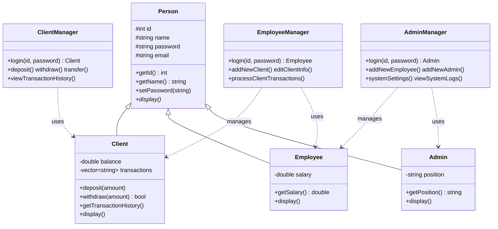
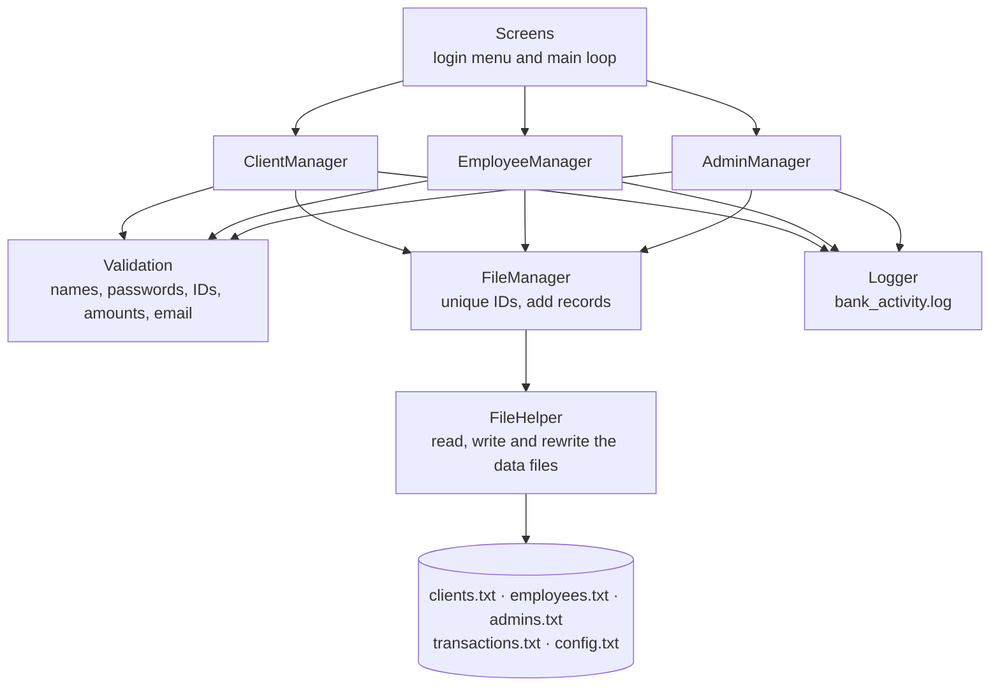

# Bank System

A console banking system in C++ with three kinds of users, each with their own menu: **admins** manage employees, **employees** manage clients, and **clients** manage their own money. Everything is saved to plain text files, passwords are stored hashed, and every action is logged.

<p align="center">
  
</p>

<p align="center"><sub>Real output from the program. An admin adds an employee, the employee opens a client account, and the client deposits, withdraws, transfers and checks the history.</sub></p>

## Who can do what

| Role | Menu |
| --- | --- |
| **Admin** | Add, list, search and edit employees · add admins · change system settings (minimum client balance, minimum salary) · view the activity log |
| **Employee** | Add, list, search and edit clients · process deposits and withdrawals for a client · view a client's transaction history |
| **Client** | Check balance · deposit · withdraw · transfer to another client · view own transaction history · update name, password and email |

Rules the program enforces: a client's balance can't drop below the minimum (default $1,500), an employee's salary can't be below the minimum (default $5,000), IDs are unique per role, names need at least 3 characters and passwords at least 6, and every login allows a limited number of attempts.

## Class hierarchy

`Client`, `Employee` and `Admin` all inherit the shared identity fields from `Person`. Each role has a manager class that holds its menu and actions.



## How the code is layered



| Layer | Classes | Job |
| --- | --- | --- |
| Interface | `Screens` | Shows the login options and hands over to the right role |
| Roles | `ClientManager`, `EmployeeManager`, `AdminManager` | One menu and set of actions per role |
| Model | `Person`, `Client`, `Employee`, `Admin` | The data and the rules that belong to it, such as deposit and withdraw |
| Services | `Validation`, `Logger`, `FileManager`, `FileHelper` | Input checks, the activity log, and file storage |

## Data files

All files are created in the folder the program runs from.

| File | Contents |
| --- | --- |
| `admins.txt` | `id,name,passwordHash,position,email` |
| `employees.txt` | `id,name,passwordHash,salary,email` |
| `clients.txt` | `id,name,passwordHash,balance,email` |
| `transactions.txt` | `clientId|timestamp|details`, e.g. `100|...|Transferred $300.00 to client 101. New balance: $5000.00` |
| `bank_activity.log` | Every login, change and error, with a timestamp |
| `config.txt` | `MIN_CLIENT_BALANCE` and `MIN_EMPLOYEE_SALARY` |

Updates are written to a temporary file first and then swapped in, so a crash can't leave a half-written data file.

## Build and run

```bash
g++ -std=c++17 First.cpp -o bank_system
./bank_system
```

**First run:** the program has no sign-up screen, so create the first admin by hand. In the folder you run it from, create `admins.txt` with one line:

```
1,Your Name,yourpassword,OWNER,you@example.com
```

Log in as Admin with ID 1 and that password, add an employee, then log in as the employee to add clients. Accounts created inside the program store their passwords hashed.

The GitHub Actions workflow builds the program with `-Wall -Wextra -pedantic` on every push.

## Built with

C++17 · object-oriented design (inheritance, encapsulation) · file I/O · GitHub Actions
